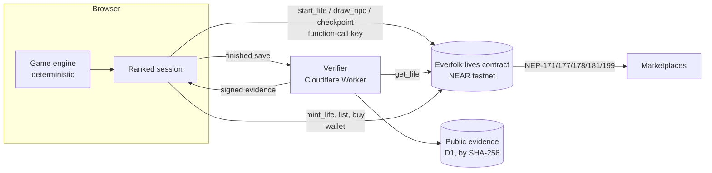

# Everfolk on NEAR — project report

**Live another story.** In every life sim, the life you lived matters to no one else. In Everfolk it does: a life you finish on NEAR becomes a token that reaches into other players' lives, and it earns whenever lives it shaped are minted or sold.

Tracks: **Games With Real Economies** (primary), **NFTs That Do Something**.

## 1. The game

Everfolk is a researched life simulation set in Rhakotis and early Alexandria, from about 350 BCE. You are born into one of sixteen household types, choose a yearly focus, answer decisions, learn thirteen skills along a skill tree, take jobs, earn and borrow, form relationships and eventually die. Over 500 authored events are grounded in cited sources; the people you play are fictional. The engine is deterministic: a seed plus the list of accepted commands *is* the life, and it replays exactly.

The game existed before the hackathon as a free, offline browser game. The hackathon work is the NEAR layer described here: a contract, a verifier, shared rules, the ranked-life session, the ranked screens, figure content, and one additive engine command.

## 2. How NEAR is used

Each use is part of how a life plays out, not decoration.

| | What happens | Why it needs NEAR |
|---|---|---|
| **A birth nobody can choose** | `start_life` takes the seed from block randomness and records which famous-figure copies shape this world. | A seed the player picks could be rerolled until it is lucky. |
| **Lives reaching into lives** | At each key decision, `draw_npc` picks a minted life from that category's pool, weighted by Affection. Its owner's chosen action, scaled by its rarity, becomes a command in your life. | The pool, the weights and the draw are shared state no single player controls. |
| **Proof before mint** | The server replays the life against its on-chain record and signs evidence; `mint_life` verifies the Ed25519 signature on chain, then rolls figure or NPC. | A browser game can be edited; the chain record and a signed replay make the claim checkable. |
| **Influence pays** | Every life whose action fired in yours is a source. Half the mint fee and 5% of every resale go to sources by impact, credited to whoever owns them now. | Royalties must follow the token through sales; NEP-199 payouts and on-chain balances do that. |

## 3. Keeping ranked lives honest

The verifier refuses to sign unless all of these hold:

- the save uses the seed and world version the contract recorded;
- it opens with exactly the figure activations the contract chose, in order;
- every on-chain draw appears at its step, and no other influence appears anywhere;
- replaying command by command, **every key decision has a draw in its category, and no draw exists where none was due**;
- a checkpoint was posted at every five-year boundary, and every recorded hash matches the save's prefix (so the life was not rewound);
- the replay ends in death, and the evidence (stats, skills, career, matched figures, sources and impacts) comes from the replay, never from the client.

The contract adds its own limits: it accepts evidence only for the matching life seed (so evidence can't be replayed on another deployment), requires 150 Tgas to mint and 100 Tgas to draw (so a player can't retry a bad roll by starving its branch of gas), caps draws and checkpoints per life, pays each token's storage out of the mint fee, and requires a wallet-signed deposit to list a token.

## 4. Economy

| | Default |
|---|---|
| Mint fee | 1 NEAR, flat, paid before the outcome is known |
| Sources' share of the mint fee | 50%, by impact on the life |
| Resale royalty | 10%: 5% to sources, 5% to treasury |
| Figure drop | 5% when the life meets the figure's requirements; 5 copies per figure |
| Rarity | Common → Legendary, influence power ×1 to ×3; figures are at least Rare |
| Affection | 1–100, how often a token is drawn |

Impact is the sum, over every time a source's action actually fired in the life, of its weight (small stat change 1, large 3, forced decision 5) times its rarity power. Shares are fixed at mint in basis points and always sum to 100%. Earnings are pulled with `withdraw`. The in-game market pays every source; external marketplaces pay as many as their `max_len_payout` allows.

Money never buys a better outcome: the fee is the same for every life, and the roll happens after the life is verified.

## 5. Figures

Four famous figures can be minted: **Euclid**, **Aristotle**, **Cleomenes** and **Alexander**. Each has requirements on the verified life (career, skills, stats, an accomplishment; Alexander also needs a royal birth) and two actions its owner switches between (for example Euclid's *Open a school* or *Keep to the Museum*; Cleomenes' *Corner the grain* or *Fill the granaries*). Requirements are calibrated by simulation: a life that deliberately follows a figure's path qualifies in about 20–30% of runs, an unfocused life essentially never. Ordinary lives become NPCs in six career groups, each with two actions of its own.

## 6. Evidence

| | |
|---|---|
| Main contract | [`everfolk-lives-11101338.testnet`](https://testnet.nearblocks.io/address/everfolk-lives-11101338.testnet): 16 NFTs from seeded lives across every draw category |
| Demo contract | [`demo.genesis-1794297139-6.testnet`](https://testnet.nearblocks.io/address/demo.genesis-1794297139-6.testnet): 100% figure drop and no empty draws, used only for the video |
| Full story on testnet | `scripts/ranked/demo-rehearsal.ts`: a copyist mints; another life is shaped by it and becomes Euclid; the copyist is paid from the mint and from Euclid's resale; a third life is born into Euclid's school. Run twice, through the local server's verifier the second time. Walkthrough: [EXAMPLE_LIFE.md](EXAMPLE_LIFE.md) |
| Tests | 101 contract unit tests (`cargo test`), 1,134 project tests (`pnpm test`), CI on every push |
| Reviews | Two independent whole-branch code reviews; all critical and important findings fixed, each with a test that failed first |

## 7. Honest limits

- **Testnet only.** Randomness is NEAR block randomness, adequate for testnet; a validator could in principle withhold a block.
- **One verifier key.** The verifier is a server key today. It sits behind a `LifeVerifier` interface so a TEE verifier can replace it without other changes.
- **Look-ahead.** Between draws a player could simulate ahead offline; draws themselves come from future blocks, so their outcome can't be known.
- **Not yet done:** a hosted public build, testing with a real wallet end to end, mainnet deployment with verified source, and the TEE verifier.

## 8. Where things are

| Path | What |
|---|---|
| `contract/` | Rust NEAR contract and its tests |
| `chain/` | Shared IDs, wire types, figure and influence catalog, ranked rules, evidence |
| `server/ranked/` | Verifier, signer, `/api/ranked/*` routes, evidence storage, rate limit |
| `client/chain/` | Wallet, contract client, ranked session, ranked screens, practice ledger |
| `src/influence.ts` | The additive engine command that applies influences |
| `scripts/ranked/` | Testnet deploy, smoke run, genesis seeding, demo rehearsal |
| `artwork/history-live/` | Character design references and figure art |

How to play: [TUTORIAL.md](TUTORIAL.md).
